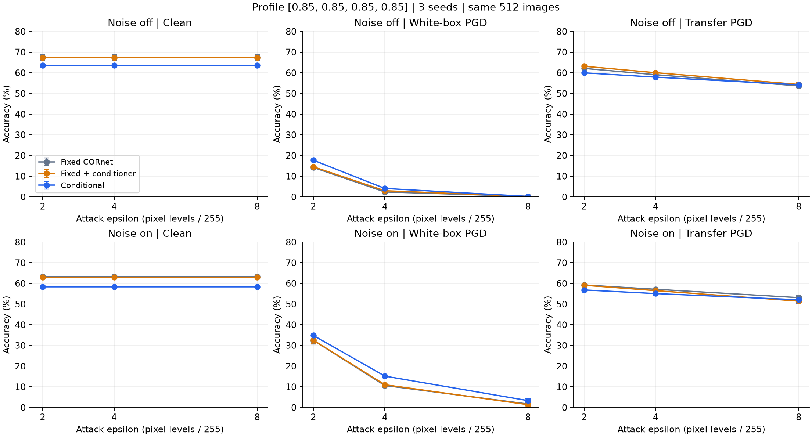

# Распознавание изображений: можно ли обучить одну сеть для разных уровней шума?

Представьте, что у нас есть фотография велосипеда. Задача сети — посмотреть на фотографию и выбрать правильную категорию «велосипед». В этом проекте мы проверяем, как часто сеть правильно узнаёт предметы, если добавить случайность в её работу. При каждом распознавании сила внутренних связей немного меняется. Мы сами задаём величину этих изменений и называем её **уровнем шума**. Чем он больше, тем сильнее могут измениться связи.

Раньше для таких опытов мы выбирали уровень шума заранее и обучали под него отдельную сеть. Чтобы сравнить пять уровней, требовалось пять обучений. Мы попробовали обучить **одну сеть сразу на разных уровнях**. Замысел такой: после обучения берём ту же фотографию и ту же сеть, задаём нужный уровень шума и получаем ответ. Нас интересовало, сохранит ли эта сеть точность пяти отдельных моделей и как она поведёт себя, если кто-то специально изменит фотографию, чтобы вызвать ошибку.

**Что получилось.** Менять уровень шума без нового обучения удалось. Сохранить точность отдельных моделей во всех условиях — пока нет. Например, при шуме 0.85 на исходных фотографиях обычная сеть, обученная специально для этого уровня, дала **63.28%** правильных ответов, а единая сеть — **58.33%**. Когда изображение специально искажали для каждой из этих сетей с одинаковым ограничением на изменение пикселей (4/255), результат был обратным: **10.61%** у отдельной сети и **15.17%** у единой. Единая сеть чаще выдерживала эту проверку, хотя обе ошибались на большинстве изменённых фотографий.

## Что означают названия моделей

Все варианты используют одну основу — сеть CORnet-RT, обученную распознавать объекты на изображениях из набора Caltech-256. У сети четыре блока обработки изображения. Для каждого блока можно указать свою силу шума. Четыре числа вместе называются **профилем**. Например, `all_085` означает шум 0.85 во всех четырёх блоках, а `[2.50, 0.70, 0.25, 0]` — сильный шум в первом блоке, слабее во втором и третьем и выключенный в четвёртом.

| Название в таблицах | Как её обучали и для чего сравниваем |
|---|---|
| **Фиксированная без модуля** | Прежний подход. Выбираем, например, 0.85 и обучаем сеть распознавать предметы при таком уровне шума. Для 0.50 обучаем другую сеть. «Фиксированная» означает, что у каждого обучения один целевой уровень. |
| **Условная** | Единая сеть, которую мы хотим получить. От одной группы учебных изображений к другой меняем профиль. Сеть получает и изображение, и четыре числа профиля. Дополнительный модуль учится по этим числам усиливать или ослаблять внутренние признаки изображения. Профиль и есть «условие», которое можно поменять после обучения. |
| **Фиксированная с модулем** | Берём устройство условной сети, включая дополнительный модуль, и обучаем отдельную копию под каждый уровень. Так можно сравнить две одинаково устроенные сети и увидеть, что меняется именно от обучения на разных профилях. |
| **Адаптивная** | В отдельном опыте постепенно повышаем шум в каждом блоке и смотрим, сколько сеть выдержит. Полученные четыре уровня затем задаём условной сети. Это проверка на случае, когда разным блокам нужен разный шум. |
| **Базовая** | Сеть, обученная распознавать предметы без внутреннего шума. С её весов начинаем обучение остальных вариантов. На ней также готовим изменённые изображения для проверки переноса атаки. |

## Как мы проверяем ответы

Всем моделям показываем одни и те же **512 тестовых изображений** с известными правильными ответами. Точность 60% означает, что примерно в шести случаях из десяти сеть правильно назвала предмет. Проверку проводим в трёх условиях.

| Что написано в таблице | Что происходит с изображением |
|---|---|
| **Без атаки** | Подаём исходную фотографию. Внутри сети при этом может быть включён шум. |
| **Прямая PGD** | Алгоритм PGD шаг за шагом меняет пиксели фотографии, стараясь заставить конкретную проверяемую модель ошибиться. Показываем полученную фотографию этой модели. |
| **Перенос с базовой** | Тем же способом меняем фотографию, стараясь обмануть базовую сеть. Показываем готовую фотографию другой сети и смотрим, повторит ли она ошибку. |

В опыте есть две разные настройки. **σ** задаёт силу случайных изменений *внутри сети*. **ε** ограничивает изменения *в самой фотографии* во время атаки. Например, при ε=4/255 значение каждого цветового канала пикселя можно сдвинуть максимум на 4 деления по шкале от 0 до 255. Значения 2/255, 4/255 и 8/255 проверяем на одних и тех же обученных моделях.

## Опыт 1. Один уровень шума во всей сети

Проверяем пять уровней — 0.25, 0.50, 0.85, 1.00 и 2.50. Для каждого берём две сети, отдельно обученные под этот уровень, и выставляем тот же уровень у единой условной сети. **Во всех строках «Условная» для одного повтора использованы одни и те же обученные веса.** В таблице внутренний шум включён.

Читайте по три строки с одинаковым σ. Каждый столбец показывает процент правильных ответов в своём испытании. **Жирным выделен лучший результат внутри тройки**, при равенстве выделены оба. Числа усреднены по трём независимым повторам обучения. Выделение показывает разницу средних, её статистическая значимость отдельно не проверялась.

| Шум σ в каждом блоке | Модель | Без атаки, % | Прямая PGD, ε=2/255, % | Прямая PGD, ε=4/255, % | Прямая PGD, ε=8/255, % | Перенос с базовой, ε=2/255, % | Перенос с базовой, ε=4/255, % | Перенос с базовой, ε=8/255, % |
|---|---|---:|---:|---:|---:|---:|---:|---:|
| 0.25 | Фиксированная без модуля | **72.85** | 4.10 | 0.13 | 0.00 | 25.39 | 8.07 | 1.04 |
| 0.25 | Фиксированная с модулем | 71.09 | 3.65 | 0.13 | 0.00 | 27.60 | 9.18 | 1.30 |
| 0.25 | Условная | 67.12 | **11.91** | **1.95** | **0.20** | **58.07** | **52.86** | **44.01** |
| 0.50 | Фиксированная без модуля | **68.36** | 16.34 | 2.80 | 0.13 | 57.29 | 46.48 | 31.32 |
| 0.50 | Фиксированная с модулем | 67.97 | 15.82 | 3.06 | 0.07 | 56.58 | 47.72 | 32.36 |
| 0.50 | Условная | 65.30 | **22.92** | **7.10** | **0.26** | **59.64** | **55.73** | **50.33** |
| 0.85 | Фиксированная без модуля | **63.28** | 32.49 | 10.61 | 1.69 | **59.24** | **57.16** | **53.12** |
| 0.85 | Фиксированная с модулем | 63.02 | 32.55 | 11.00 | 1.37 | 59.11 | 56.51 | 51.43 |
| 0.85 | Условная | 58.33 | **34.83** | **15.17** | **3.32** | 56.84 | 55.08 | 52.08 |
| 1.00 | Фиксированная без модуля | 59.90 | 35.68 | 14.26 | 2.73 | **57.94** | **56.45** | **53.19** |
| 1.00 | Фиксированная с модулем | **60.42** | 34.90 | 14.26 | 2.60 | 57.81 | 56.05 | 52.86 |
| 1.00 | Условная | 54.30 | **36.39** | **19.92** | **5.34** | 53.52 | 52.86 | 50.26 |
| 2.50 | Фиксированная без модуля | 25.39 | **21.48** | **16.93** | 9.51 | **25.46** | **25.26** | 24.93 |
| 2.50 | Фиксированная с модулем | **25.65** | **21.48** | 16.80 | **9.70** | 25.07 | 25.13 | **25.33** |
| 2.50 | Условная | 6.58 | 6.25 | 6.25 | 6.25 | 6.32 | 6.05 | 6.18 |

На всех четырёх уровнях от 0.25 до 1.00 картина повторилась: на исходных фотографиях обе отдельно обученные сети точнее условной, а после прямой атаки условная даёт больше правильных ответов при каждой из трёх сил атаки. При переносе атаки с базовой сети условная модель точнее обеих фиксированных при шуме 0.25 и 0.50 для всех трёх ε. При шуме 0.85 и 1.00 для всех трёх ε лидирует фиксированная модель без модуля. При 2.50 все три сети плохо узнают даже исходные фотографии: у отдельных сетей около 25–26% правильных ответов, у условной — 6.58%.


Слева показана точность на исходных фотографиях, справа — после прямой атаки 4/255. В верхнем ряду внутренний шум выключен на время проверки, в нижнем включён. Серая линия — отдельная сеть без модуля, оранжевая — отдельная с модулем, синяя — единая условная. Вертикальные отрезки показывают стандартное отклонение между повторами обучения.

## Опыт 2. Что меняется, если усилить атаку?

Оставим у условной сети профиль 0.85 и внутренний шум включённым. При слабой прямой атаке (2/255) сеть правильно распознаёт **34.83%** изображений, при средней (4/255) — **15.17%**, при сильной (8/255) — **3.32%**. Если при тех же 8/255 подготовить искажения на базовой сети, условная распознаёт **52.08%**. Поэтому для оценки устойчивости важно знать, против какой сети подбирали изменения фотографии.



На графике можно также сравнить верхний и нижний ряды. Это те же обученные сети с выключенным и включённым внутренним шумом. У условной сети включение шума снижает точность на исходных фотографиях с 63.61% до 58.33% и повышает точность после прямой атаки 4/255 с 4.04% до 15.17%.

## Опыт 3. Что будет, если каждому блоку нужен свой уровень шума?

Здесь мы позволяем отдельной сети подобрать четыре уровня в ходе обучения. Начинаем с одного блока и ступенями повышаем в нём шум. После каждой ступени проверяем точность на отложенных учебных данных. Допускаем падение максимум на **10 процентных пунктов** относительно базовой сети. Например, если бы у базовой было 70% правильных ответов, ступень с 60% ещё подошла бы. При большем падении возвращаем последнюю принятую версию и переходим к следующему блоку. Время обучения ограничено, поэтому пробуем три порядка обхода блоков.

Читайте строки парами. **Первая строка каждой пары — адаптивная сеть.** Во время её обучения мы по очереди повышали шум в блоках и запоминали принятые уровни. **Вторая строка — условная сеть.** Берём уже обученную сеть того же повтора, выставляем ей те же четыре уровня и проверяем на тех же изображениях. Поэтому внутри пары настройки совпадают, а точность может различаться.

Стрелки показывают, в каком порядке повышали шум. В квадратных скобках числа **всегда** записаны в порядке **[V1, V2, V4, IT]**, даже когда поиск начинался с IT или V2. Слева от скобок указан номер повтора. Проценты в строке усреднены по перечисленным повторам. При проверке внутренний шум включён.

Точность без атаки взята из прогона 4/255. В остальных столбцах указана точность после атаки при соответствующем ε. Жирным выделена большая средняя точность внутри пары, при равенстве выделены обе.

| Порядок поиска | Какую сеть проверяем | Повтор → уровни шума [V1, V2, V4, IT] | Без атаки, % | Прямая PGD 2/255, % | Прямая PGD 4/255, % | Прямая PGD 8/255, % | Перенос 2/255, % | Перенос 4/255, % | Перенос 8/255, % |
|---|---|---|---:|---:|---:|---:|---:|---:|---:|
| V1 → V2 → V4 → IT (`forward`) | Адаптивная — подобрала профиль | 44 → [2.50, 0.40, 0.55, 0.00]<br>42, 43 → [2.50, 0.70, 0.25, 0.00] | **60.74** | **35.22** | 16.93 | 3.52 | **58.07** | **57.23** | **54.30** |
| V1 → V2 → V4 → IT | Условная — получила готовый профиль | 44 → [2.50, 0.40, 0.55, 0.00]<br>42, 43 → [2.50, 0.70, 0.25, 0.00] | 52.28 | **35.22** | **22.66** | **8.85** | 52.21 | 51.30 | 49.28 |
| IT → V4 → V2 → V1 (`reverse`) | Адаптивная — подобрала профиль | 43 → [0.00, 0.00, 0.85, 2.50]<br>42 → [0.00, 0.25, 0.70, 2.50] | **59.57** | 0.49 | 0.00 | **0.00** | 14.84 | 3.61 | 0.39 |
| IT → V4 → V2 → V1 | Условная — получила готовый профиль | 43 → [0.00, 0.00, 0.85, 2.50]<br>42 → [0.00, 0.25, 0.70, 2.50] | 42.97 | **13.09** | **2.93** | **0.00** | **39.06** | **36.04** | **30.18** |
| V2 → V1 → V4 → IT (`v2_first`) | Адаптивная — подобрала профиль | 43 → [0.00, 2.25, 0.70, 0.10]<br>42 → [0.25, 2.25, 0.70, 0.00] | **62.01** | 17.58 | 3.61 | 0.20 | **53.61** | 46.39 | 35.35 |
| V2 → V1 → V4 → IT | Условная — получила готовый профиль | 43 → [0.00, 2.25, 0.70, 0.10]<br>42 → [0.25, 2.25, 0.70, 0.00] | 52.34 | **32.62** | **16.41** | **2.25** | 50.98 | **49.12** | **46.09** |

Для повтора 44 также известны профили обратного порядка [0.00, 0.25, 0.70, 2.50] и порядка с V2 первым [0.10, 2.25, 0.85, 0.00]. Для них ещё нет парной оценки с включённым шумом, поэтому средние этих двух порядков рассчитаны по повторам 42 и 43.

На исходных изображениях адаптивная сеть точнее при всех трёх порядках поиска. При прямой атаке условная точнее в семи из девяти сравнений. В двух остальных средние совпали: при прямом порядке и ε=2/255 обе сети дали 35.22%, при обратном порядке и ε=8/255 обе дали 0.00%. При переносе преимущество зависит от порядка и силы атаки. График ниже показывает результаты без атаки и при прямой атаке 4/255.


## Сколько результатов готово

На 19 ноября 2026 года сохранены **387 из 396 оценок**. Все сравнения на пяти одинаковых уровнях шума завершены. Остались девять оценок адаптивной сети для третьего повтора (seed 44): обратный порядок с включённым шумом и порядок с V2 первым в обоих режимах.

Всего выполнено **45 обучений**. В каждом из трёх повторов обучили одну базовую, одну условную, десять фиксированных (пять уровней с модулем и пять без него) и три адаптивные сети. Число **396** относится к проверкам уже полученных весов: 132 сочетания модели, профиля и режима внутреннего шума проверяем при трёх значениях ε.

<details>
<summary>Технические условия и воспроизведение</summary>

Четыре блока CORnet-RT обозначаются V1, V2, V4 и IT. Шум умножает веса свёрток на случайные коэффициенты. В условной сети модуль NoiseConditioner по профилю шума задаёт поканальный масштаб и сдвиг признаков. Профиль `zero` задаёт четыре нуля уже обученной условной модели. Режим `off` отключает случайность при проверке, при этом модуль продолжает получать выбранный профиль.

Базовую сеть обучаем 10 эпох с обновлением классификатора и ещё 40 эпох с обновлением всей сети. Остальные варианты начинают с базовой сети того же повтора и получают по 100 эпох обучения. У условной и фиксированных моделей первые пять эпох проходят без шума, за следующие 25 эпох достигается целевая интенсивность или верхняя граница диапазона. У условной сети 20% групп изображений получают нулевой профиль, 30% — одинаковый случайный уровень во всех блоках, 30% — шум в одном блоке, 20% — независимые уровни. Для сравнения берём веса последней эпохи. У адаптивной сети каждая ступень занимает четыре эпохи, а отвергнутые ступени также расходуют бюджет.

Оценка использует одну тестовую подвыборку (seed 2026). Для PGD выполняем 50 шагов длиной ε/4 и пять рестартов. При включённом ненулевом шуме усредняем градиент по 16 реализациям шума, предсказания — по трём. В первой таблице точность без атаки взята из прогона с ε=4/255. Выводы относятся к этой подвыборке и этим условиям атаки.

На сервере из каталога с `main.py` таблицы и графики можно обновить командами ниже. В локальном репозитории этот каталог называется `src`. Обученные веса хранятся на сервере.

```bash
python3 experiments/comparison/summarize.py results/comparison_v1
python3 experiments/comparison/plot.py results/comparison_v1
```

</details>

Данные и настройки для воспроизведения: [все измерения](results/comparison_v1/results.csv), [средние и стандартные отклонения](results/comparison_v1/summary.csv), [отдельные оценки](results/comparison_v1/evaluation), [подробный протокол и команды запуска](src/experiments/comparison/README.md).
