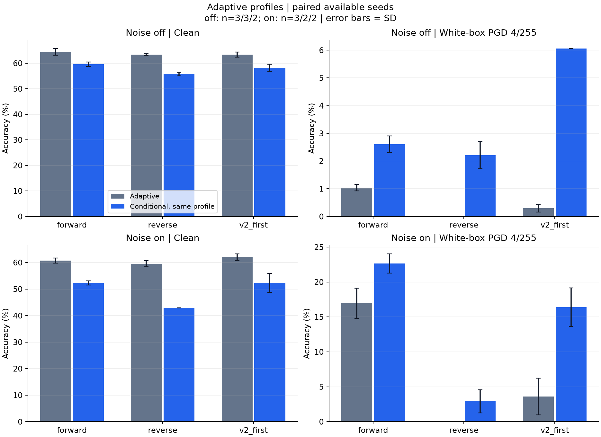

# Может ли одна CORnet-RT заменить отдельные модели для разных уровней шума?

Модель распознаёт объекты на изображениях Caltech-256. Мы меняем силу случайного шума в весах четырёх блоков сети. Четыре числа, по одному на блок, образуют **профиль шума**. В прежнем подходе для каждого нужного уровня мы обучали свою сеть. В этом эксперименте одну сеть обучаем на разных профилях, а затем меняем профиль при проверке, сохраняя те же веса.

Например, чтобы проверить шум 0.25 и 0.85, у фиксированных моделей берём два набора весов, каждый после своего обучения. У **условной модели** берём один набор весов и дважды запускаем его с разными значениями на входе. Проверяем, какую долю изображений каждая модель распознаёт правильно в обычных условиях и после намеренного искажения изображения атакой PGD.

**Что получилось.** Переключать профиль без переобучения удалось. При включённом шуме на уровнях 0.25–1.00 условная модель во всех четырёх случаях уступает обеим отдельно обученным моделям на чистых изображениях и превосходит обе после прямой атаки при всех трёх проверенных ε. При общем шуме 2.50 точность условной модели на чистых изображениях падает до 6.58%. Заменить набор моделей с сохранением их точности во всех условиях пока не удалось.

**Готовность на 19 ноября 2026 года.** Сохранены 387 из 396 оценок. Сравнение на пяти общих уровнях завершено для всех трёх независимых обучений (seed 42, 43, 44). Девять недостающих оценок относятся к адаптивному поиску с seed 44 — обратному порядку с включённым шумом и порядку с V2 первым в обоих режимах.

Источники — [все измерения](results/comparison_v1/results.csv),
[агрегированная таблица](results/comparison_v1/summary.csv) и
[отдельные прогоны с метаданными](results/comparison_v1/evaluation).
Подробный протокол и команды находятся в
[README эксперимента](src/experiments/comparison/README.md).

## Какие модели сравниваем и зачем

CORnet-RT обрабатывает изображение через блоки V1 → V2 → V4 → IT и классификатор
на 257 классов Caltech-256. В ConditionalCORnetRT добавлен NoiseConditioner.
Профиль `[σV1, σV2, σV4, σIT]` задаёт мультипликативный шум весов свёрток
и поступает в conditioner, который формирует поканальные масштаб и сдвиг признаков.

`all_025` означает `[0.25, 0.25, 0.25, 0.25]`, `all_085` —
`[0.85, 0.85, 0.85, 0.85]`. `zero` — нулевой профиль уже обученной условной сети.
В таблицах «модуль» означает NoiseConditioner.
В режиме `off` случайный шум выключен, но conditioner продолжает получать
заданный профиль. В режиме `on` случайный шум включён.

| Название в отчёте | Как выбирается шум | Зачем нужна модель | Обучений на трёх seed |
|---|---|---|---:|
| Базовая (baseline) | Обучается без шума | Даёт начальные веса всем вариантам. На ней также строим переносимые атаки | 3 |
| Фиксированная без модуля | Для каждого из пяти уровней обучаем отдельную обычную CORnet-RT | Показывает результат прежнего подхода при заранее известном уровне шума | 15 |
| Фиксированная с модулем | Для каждого уровня обучаем отдельную сеть. Дополнительный модуль получает профиль и по нему меняет масштаб и сдвиг признаков | Сравнение с предыдущей строкой показывает эффект добавления модуля при том же режиме обучения | 15 |
| Условная | Тот же модуль, но профиль меняется между обучающими батчами. После обучения один набор весов работает с разными профилями | Сравнение с фиксированной моделью с модулем показывает эффект обучения на множестве профилей при одной архитектуре | 3 |
| Адаптивная | В ходе обучения повышаем шум по одному блоку и принимаем ступень по точности на валидации | Проверяем, как условная модель работает на профиле, который другая сеть подобрала в ходе обучения | 9 |
| **Всего обучений** | | | **45** |

Baseline обучается 10 эпох только с новой головой и 40 эпох целиком.
Каждая последующая модель начинает с baseline соответствующего seed и получает
бюджет 100 эпох, batch size 32, AdamW с lr=1e-4 и weight decay=1e-4,
cosine learning rate на 100 эпох. Seed — 42, 43, 44.

Фиксированные и условные варианты начинают с пяти эпох без шума. Затем за 25 эпох
интенсивность специалиста достигает его целевого уровня, а верхняя граница
распределения условной модели достигает 2.50. Профиль общий для всего batch.
В условном обучении 20% batch имеют нулевой профиль, 30% — одну общую случайную
интенсивность, 30% — шум в одном блоке, 20% — независимые интенсивности блоков.
Веса сети и, при его наличии, модуля обучаются по функции потерь cross-entropy. Для этих вариантов
оцениваются веса последней эпохи.

Адаптивный метод после пяти эпох без шума повышает интенсивность ступенями
от 0.10 до 2.50, по четыре эпохи на ступень. Ступень принимается, пока clean
validation accuracy не ниже baseline минус **10 процентных пунктов**.
При нарушении порога восстанавливаются последние принятые веса и оптимизатор.
Не менее десяти эпох отведено консолидации с возможным откатом.
Общий бюджет ограничен 100 эпохами, включая отвергнутые ступени.
Из-за этого поиск может закончиться до проверки всех уровней во всех блоках.

## Протокол оценки

Все метрики ниже рассчитаны на одинаковых **512 случайно выбранных test-изображениях**,
с subset seed 2026. Проверена идентичность индексов во всех 387 JSON-файлах.

- White-box PGD строится непосредственно против проверяемой модели с её профилем и режимом шума.
- Transfer PGD строится на baseline того же seed, после чего изображения подаются целевой модели.
- Для каждого ε используется 50 шагов PGD, шаг ε/4 и пять рестартов.
- При ненулевом включённом шуме градиент усредняется по 16 реализациям (EOT), предсказания — по трём реализациям (MC).
- Для детерминированного режима используется по одному вычислению.
- При смене ε используются те же сохранённые веса.

Для оценки используются 42 checkpoint. Пять общих профилей условной модели,
zero и три адаптивных профиля вместе с двумя режимами шума дают 132 конфигурации.
Три ε на конфигурацию дают 396 прогонов. Baseline служит источником transfer-атак.

## 1. Какая модель точнее при одном и том же уровне шума?

В каждой группе из трёх строк все четыре блока получают указанный уровень шума σ. Шум включён во время оценки, в том числе на чистых изображениях. «Чистые» означает, что изображение подали без атаки. При прямой атаке PGD искажение подбирают для самой проверяемой модели, при переносе — для базовой модели. Величина ε ограничивает, насколько атака может изменить значение пикселя.

Все столбцы с результатами показывают **процент правильных ответов**, усреднённый по трём seed на одних и тех же 512 изображениях. Чем выше, тем лучше. **Жирным** отмечен максимум в каждом столбце среди трёх моделей **при одном σ**. При равенстве показанных значений выделены обе модели. Выделение сравнивает средние, статистическая значимость не проверялась. Для чистых изображений взято измерение из прогона с ε=4/255. Стандартные отклонения приведены на графиках и в `summary.csv`.

| Шум σ в каждом блоке | Модель | Без атаки, % | Прямая PGD, ε=2/255, % | Прямая PGD, ε=4/255, % | Прямая PGD, ε=8/255, % | Перенос с базовой, ε=8/255, % |
|---|---|---:|---:|---:|---:|---:|
| 0.25 | Фиксированная без модуля | **72.85** | 4.10 | 0.13 | 0.00 | 1.04 |
| 0.25 | Фиксированная с модулем | 71.09 | 3.65 | 0.13 | 0.00 | 1.30 |
| 0.25 | Условная | 67.12 | **11.91** | **1.95** | **0.20** | **44.01** |
| 0.50 | Фиксированная без модуля | **68.36** | 16.34 | 2.80 | 0.13 | 31.32 |
| 0.50 | Фиксированная с модулем | 67.97 | 15.82 | 3.06 | 0.07 | 32.36 |
| 0.50 | Условная | 65.30 | **22.92** | **7.10** | **0.26** | **50.33** |
| 0.85 | Фиксированная без модуля | **63.28** | 32.49 | 10.61 | 1.69 | **53.12** |
| 0.85 | Фиксированная с модулем | 63.02 | 32.55 | 11.00 | 1.37 | 51.43 |
| 0.85 | Условная | 58.33 | **34.83** | **15.17** | **3.32** | 52.08 |
| 1.00 | Фиксированная без модуля | 59.90 | 35.68 | 14.26 | 2.73 | **53.19** |
| 1.00 | Фиксированная с модулем | **60.42** | 34.90 | 14.26 | 2.60 | 52.86 |
| 1.00 | Условная | 54.30 | **36.39** | **19.92** | **5.34** | 50.26 |
| 2.50 | Фиксированная без модуля | 25.39 | **21.48** | **16.93** | 9.51 | 24.93 |
| 2.50 | Фиксированная с модулем | **25.65** | **21.48** | 16.80 | **9.70** | **25.33** |
| 2.50 | Условная | 6.58 | 6.25 | 6.25 | 6.25 | 6.18 |


Верхний ряд показывает инференс без случайного шума, нижний — с шумом.
На горизонтальной оси перечислены пять проверенных уровней как отдельные категории.
При уровнях 0.25–1.00 обычные специалисты и специалисты с conditioner дают близкие
результаты. Совместное обучение на распределении профилей меняет компромисс сильнее,
чем добавление conditioner к фиксированному специалисту.

По сравнению со специалистом той же архитектуры на уровне 0.50 условная модель
теряет 2.67 п.п. clean accuracy, но выигрывает 4.04 п.п. прямой PGD 4/255
и 17.97 п.п. transfer PGD 8/255. На уровне 0.85 clean ниже на 4.69 п.п.,
прямая PGD 4/255 выше на 4.17 п.п., а transfer PGD 8/255 отличается лишь на +0.65 п.п.
На уровне 1.00 clean ниже на 6.12 п.п., прямая PGD 4/255 выше на 5.66 п.п.,
а transfer PGD 8/255 ниже на 2.60 п.п. Это описательные различия средних,
статистическая значимость отдельно не проверялась.

Общий уровень 2.50 сильно снижает обычное качество. У условной модели clean
равен 6.58%, у специалистов около 25–26%. Повышенная остаточная accuracy
специалистов после PGD на этом уровне сопровождается большим падением clean.

## 2. Что меняется, если усилить атаку или выключить шум при проверке?


При all_085 с включённым шумом у условной модели прямая PGD accuracy падает
с 34.83% при 2/255 до 15.17% при 4/255 и 3.32% при 8/255.
У специалиста с conditioner соответствующие значения равны 32.55%, 11.00% и 1.37%.
Сильная прямая атака по-прежнему существенно разрушает классификацию.

Случайный шум при инференсе меняет результат даже при одном и том же checkpoint.
У условной all_085 его включение снижает clean с 63.61% до 58.33%,
но повышает прямую PGD 4/255 с 4.04% до 15.17%.
У специалиста с conditioner clean меняется с 67.25% до 63.02%,
а прямая PGD 4/255 — с 2.93% до 11.00%.

По transfer PGD 8/255 условная all_085 сохраняет 52.08%, тогда как по прямой
PGD остаётся 3.32%. Такой разрыв показывает ограниченную переносимость атак
с baseline и сохраняющуюся уязвимость к атаке на саму модель.

## 3. Может ли условная модель воспроизвести результат адаптивного поиска?

Для каждого seed адаптивная сеть подбирала профиль, последовательно повышая шум в блоках в указанном ниже порядке. Затем мы подавали **именно этот профиль** уже обученной условной модели того же seed. Сравниваем две модели на одинаковых изображениях с включённым шумом при ε=4/255. Для каждого порядка берём только те seed, для которых готовы обе оценки. **Жирным** выделена большая средняя точность в каждой паре моделей по каждому столбцу.

| Порядок повышения шума | Общие seed | Модель | Без атаки, % | Прямая PGD, ε=4/255, % | Перенос с базовой, ε=4/255, % |
|---|---|---|---:|---:|---:|
| V1 → V2 → V4 → IT (`forward`) | 42, 43, 44 | Адаптивная | **60.74** | 16.93 | **57.23** |
| V1 → V2 → V4 → IT | 42, 43, 44 | Условная | 52.28 | **22.66** | 51.30 |
| IT → V4 → V2 → V1 (`reverse`) | 42, 43 | Адаптивная | **59.57** | 0.00 | 3.61 |
| IT → V4 → V2 → V1 | 42, 43 | Условная | 42.97 | **2.93** | **36.04** |
| V2 → V1 → V4 → IT (`v2_first`) | 42, 43 | Адаптивная | **62.01** | 3.61 | 46.39 |
| V2 → V1 → V4 → IT | 42, 43 | Условная | 52.34 | **16.41** | **49.12** |



Прямой порядок концентрирует сильный шум в V1. Например, у seed 42 и 43
получился профиль [2.50, 0.70, 0.25, 0]. Обратный порядок концентрирует шум в IT.
У v2_first максимальная принятая интенсивность V2 равна 2.25.
Полные профили и решения ступеней сохранены в result.json и adaptive_history.csv.

В доступных парах условная модель уступает адаптивной по clean и превосходит
её по прямой PGD 4/255. По transfer результат зависит от порядка.
Наиболее полное сравнение forward показывает потерю clean на 8.46 п.п.,
выигрыш прямой PGD на 5.73 п.п. и потерю transfer PGD на 5.92 п.п.
Предельные интенсивности всех блоков требуют отдельной интерпретации,
поскольку ограничение в 100 эпох иногда останавливает поиск раньше завершения сетки.

## Вывод и воспроизведение

Один условный checkpoint поддерживает разные профили без повторного обучения.
В общем диапазоне 0.25–1.00 он позволяет выбирать между clean и текущей PGD
accuracy, но уступает отдельно обученным специалистам по clean при тех же условиях.
Диапазон до 2.50 охвачен обучением, однако общий профиль 2.50 даёт резкое падение
точности. Сводные данные подтверждают компромисс между универсальностью,
обычным качеством и устойчивостью, зависящий от профиля.

Оценка использует конечную PGD/EOT-конфигурацию и 512 изображений.
Для reverse и v2_first нужно досчитать указанные seed перед полным сравнением
по трём seed. Старые метрики из предыдущего README получены другим протоколом
и заменены в этом отчёте текущим согласованным сравнением.

На сервере команды выполняются из каталога с main.py и experiments.
Получить таблицы и обновить графики после завершения новых прогонов можно так:

```bash
python3 experiments/comparison/summarize.py results/comparison_v1
python3 experiments/comparison/plot.py results/comparison_v1
```

В этом репозитории код лежит в src. При запуске из корня локального checkout
используйте путь src/experiments/comparison/plot.py.

Локальные 45 файлов model.pt удалены по запросу. В репозитории сохранены метрики,
метаданные прогонов, истории обучения и графики. Checkpoint остаются на сервере.
