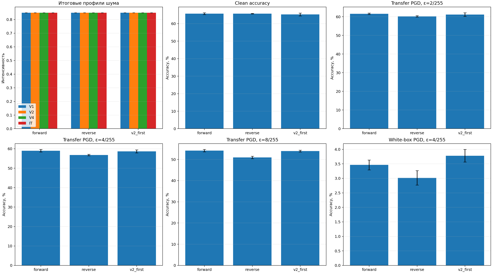
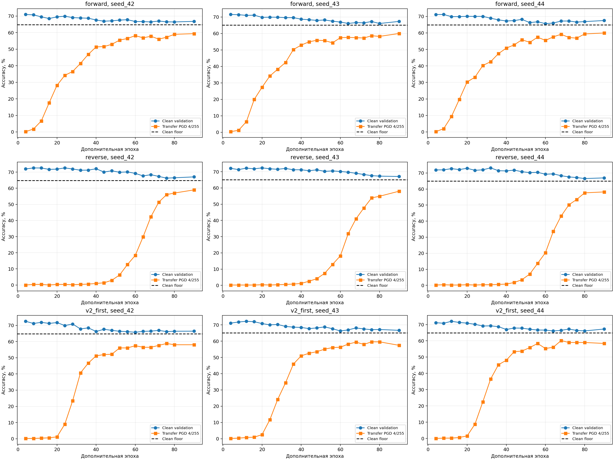
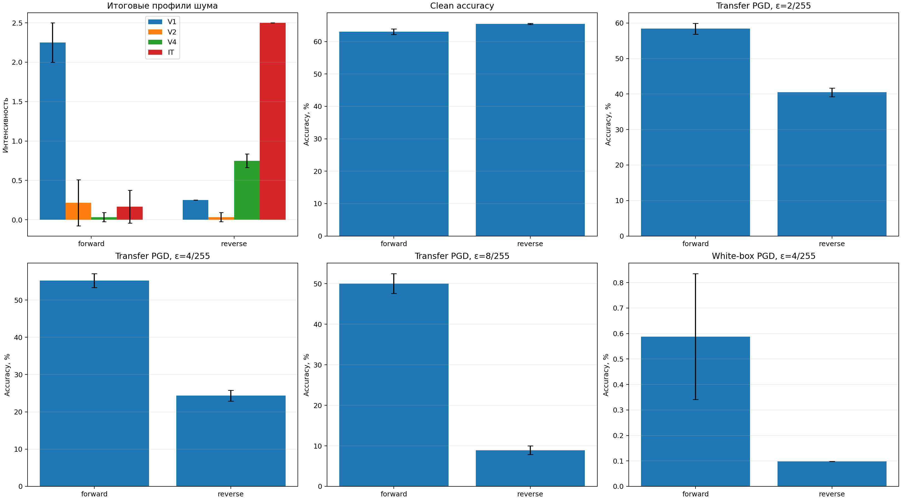
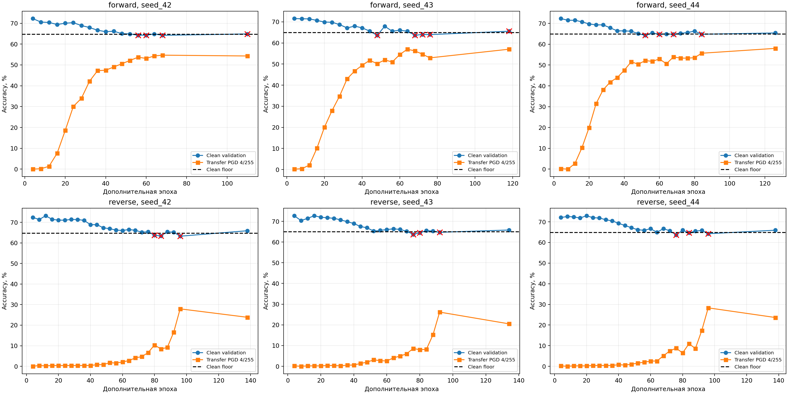

# Адаптивный последовательный рост аксонального шума в CORnet-RT

## Цель эксперимента

В эксперименте проверялось, можно ли последовательно увеличивать аксональный шум в блоках CORnet-RT, сохраняя приемлемое качество на чистых изображениях и повышая устойчивость к переносимым атакам. Отдельно исследовалось влияние порядка настройки блоков.

В качестве исходных использовались baseline-модели для трёх случайных инициализаций: 42, 43 и 44. Эксперимент проводился на Caltech-256: 24 791 изображение для обучения, 2 755 для валидации и 3 061 для тестирования.

## Модель и шум

CORnet-RT состоит из последовательных зрительных блоков V1, V2, V4 и IT. Аксональный шум применялся к параметрам свёрток `conv_input` и рекуррентной `conv1` выбранного блока во время обучения. На обычном инференсе стохастический шум отключался: итоговые метрики характеризуют обученные веса, а не случайное зашумление предсказаний.

Интенсивность шума в каждом блоке последовательно проходила уровни 0.25, 0.40, 0.55, 0.70 и 0.85. На каждом уровне выполнялось четыре эпохи. После обработки всех четырёх блоков модель дополнительно обучалась десять эпох для консолидации. Максимальная длина одного запуска составляла 90 эпох.

Рост разрешался, пока валидационная accuracy не падала более чем на 10 процентных пунктов относительно baseline. Для дополнительного наблюдения контролировалась transfer PGD при $\varepsilon=4/255$ на фиксированной части валидации. Эта метрика не заменяла ограничение по clean accuracy.

Проверялись три порядка:

| Профиль | Порядок настройки |
|---|---|
| `forward` | V1 → V2 → V4 → IT |
| `reverse` | IT → V4 → V2 → V1 |
| `v2_first` | V2 → V1 → V4 → IT |

Итого обучено девять моделей: три порядка × три seed.

## Оценка атак

Итоговые модели проверялись на FGSM и PGD при $\varepsilon=2/255$, $4/255$ и $8/255$. Для PGD использовалось 10 шагов и шаг $\alpha=\varepsilon/4$. Оценка выполнялась в двух режимах:

- **white-box** — атака строилась непосредственно на тестируемой модели;
- **baseline-transfer** — атакованные изображения строились на baseline-модели того же seed и переносились на модель с шумом.

## Результаты

Исходные данные: [результаты отдельных запусков](results/adaptive/adaptive_results.csv), [агрегированные результаты](results/adaptive/adaptive_summary.csv), [transfer seed 42](results/adaptive/transfer_seed_42.csv), [transfer seed 43](results/adaptive/transfer_seed_43.csv), [transfer seed 44](results/adaptive/transfer_seed_44.csv).

Во всех девяти запусках контроллер принял максимальный проверенный уровень 0.85 для каждого блока. Поэтому финальные профили совпали: V1=V2=V4=IT=0.85, суммарная интенсивность равна 3.4, а обучение заняло 90 эпох. Откатов не было. Это важно: текущий эксперимент не нашёл индивидуальные предельные интенсивности блоков, а фактически сравнил три порядка одного и того же curriculum.

### PGD, среднее ± стандартное отклонение по трём seed

| Порядок | Clean | White-box 2/255 | White-box 4/255 | White-box 8/255 | Transfer 2/255 | Transfer 4/255 | Transfer 8/255 |
|---|---:|---:|---:|---:|---:|---:|---:|
| forward | **65.73 ± 0.51** | 15.13 ± 0.24 | 3.46 ± 0.17 | 0.29 ± 0.09 | **61.59 ± 0.33** | **59.00 ± 0.66** | **54.14 ± 0.56** |
| reverse | 65.72 ± 0.18 | 14.81 ± 0.27 | 3.02 ± 0.25 | 0.29 ± 0.07 | 60.21 ± 0.40 | 56.79 ± 0.41 | 50.94 ± 0.57 |
| v2_first | 65.23 ± 0.83 | **15.35 ± 0.12** | **3.78 ± 0.22** | **0.33 ± 0.12** | 61.17 ± 0.97 | 58.68 ± 0.78 | 53.97 ± 0.43 |

### FGSM, среднее ± стандартное отклонение по трём seed

| Порядок | White-box 2/255 | White-box 4/255 | White-box 8/255 | Transfer 2/255 | Transfer 4/255 | Transfer 8/255 |
|---|---:|---:|---:|---:|---:|---:|
| forward | **27.04 ± 0.42** | **16.69 ± 0.34** | **10.54 ± 0.31** | **60.29 ± 0.56** | 54.62 ± 0.57 | 45.67 ± 0.63 |
| reverse | 26.00 ± 0.18 | 15.79 ± 0.67 | 9.21 ± 0.35 | 58.62 ± 0.50 | 52.28 ± 0.57 | 42.71 ± 0.87 |
| v2_first | 26.31 ± 0.49 | 16.49 ± 0.22 | 10.46 ± 0.73 | 59.78 ± 0.89 | **54.83 ± 0.62** | **45.99 ± 0.78** |

## Интерпретация

Лучший общий результат по transfer PGD показал прямой порядок V1 → V2 → V4 → IT. По сравнению с обратным порядком его преимущество наблюдалось на каждом из трёх seed и увеличивалось вместе с силой атаки: в среднем +1.38 п.п. при 2/255, +2.21 п.п. при 4/255 и +3.20 п.п. при 8/255. При этом clean accuracy у этих двух вариантов практически одинакова. Это указывает, что последовательная настройка ранних зрительных блоков перед поздними выгоднее для защиты от переноса атак.

Порядок V2 → V1 → V4 → IT дал немного лучшие средние значения white-box PGD, однако выигрыш относительно `forward` мал, clean accuracy ниже примерно на 0.5 п.п., а разброс между seed больше. Поэтому считать его уверенно лучшим нельзя.

Основное ограничение видно из разрыва между transfer и white-box. Например, у `forward` при PGD 4/255 transfer accuracy равна 59.00%, тогда как white-box accuracy — только 3.46%; при 8/255 это 54.14% против 0.29%. Следовательно, высокий результат transfer в первую очередь означает, что граница решения модели с шумом отличается от границы baseline и атаки плохо переносятся. Это не означает полноценную устойчивость: адаптивная атака, построенная непосредственно на новой модели, почти полностью её разрушает.

Clean accuracy итоговых моделей составляет около 65–66%. Контроллер допустил максимальный уровень во всех блоках, потому что падение не превысило заданный порог в 10 процентных пунктов. Из-за этого текущая сетка закончилась раньше, чем был найден реальный предел допустимого шума.

## Вывод по диапазону до 0.85

Адаптивный последовательный рост аксонального шума повысил устойчивость к атакам, перенесённым с baseline-модели, причём наиболее удачным оказался порядок от ранних блоков к поздним. Результат воспроизводится на трёх seed. Однако эксперимент не подтвердил защиту от white-box атак: при сильной PGD качество осталось близким к нулю.

В первом эксперименте верхний уровень 0.85 был принят во всех блоках. Поэтому был проведён второй эксперимент с расширением диапазона до 2.50.

## Расширенный эксперимент: диапазон от 0.10 до 2.50

Во втором эксперименте проверялись уровни 0.10, 0.25, 0.40, 0.55, 0.70, 0.85, 1.00, 1.25, 1.50, 1.75, 2.00, 2.25 и 2.50. На каждом уровне выполнялись четыре эпохи. После последовательного поиска были предусмотрены 42 эпохи консолидации. Максимальный бюджет составлял 250 эпох, но все модели завершили поиск раньше из-за отклонения уровней, нарушавших ограничение по clean validation accuracy.

Проверялись два порядка на трёх seed:

- `forward`: V1 → V2 → V4 → IT;
- `reverse`: IT → V4 → V2 → V1.

Всего обучено шесть моделей. Исходные данные: [отдельные запуски](results/adaptive_extended/adaptive_results.csv), [агрегированные результаты](results/adaptive_extended/adaptive_summary.csv), [transfer seed 42](results/adaptive_extended/transfer_seed_42.csv), [transfer seed 43](results/adaptive_extended/transfer_seed_43.csv), [transfer seed 44](results/adaptive_extended/transfer_seed_44.csv).

### Найденные профили

| Порядок | Seed | V1 | V2 | V4 | IT | Сумма | Эпохи | Консолидация |
|---|---:|---:|---:|---:|---:|---:|---:|---|
| forward | 42 | 2.50 | 0.00 | 0.00 | 0.10 | 2.60 | 110 | rollback |
| forward | 43 | 2.00 | 0.55 | 0.00 | 0.00 | 2.55 | 118 | rollback |
| forward | 44 | 2.25 | 0.10 | 0.10 | 0.40 | 2.85 | 126 | accept |
| reverse | 42 | 0.25 | 0.00 | 0.85 | 2.50 | 3.60 | 138 | accept |
| reverse | 43 | 0.25 | 0.00 | 0.70 | 2.50 | 3.45 | 134 | accept |
| reverse | 44 | 0.25 | 0.10 | 0.70 | 2.50 | 3.55 | 138 | accept |

Прямой порядок концентрирует шум в V1: среднее значение V1 равно 2.25, а поздние блоки почти не зашумляются. Обратный порядок приводит к противоположному профилю: IT всегда достигает 2.50, V4 останавливается около 0.70–0.85, а V1 остаётся на 0.25. Следовательно, алгоритм сильно зависит от порядка: первый обрабатываемый блок расходует основную часть допустимого снижения clean accuracy и ограничивает рост в следующих блоках.

### PGD, среднее ± стандартное отклонение по трём seed

| Порядок | Clean | White-box 2/255 | White-box 4/255 | White-box 8/255 | Transfer 2/255 | Transfer 4/255 | Transfer 8/255 |
|---|---:|---:|---:|---:|---:|---:|---:|
| forward | 63.04 ± 0.85 | **5.30 ± 1.69** | **0.59 ± 0.25** | **0.05 ± 0.02** | **58.41 ± 1.52** | **55.23 ± 1.84** | **50.03 ± 2.42** |
| reverse | **65.44 ± 0.20** | 1.71 ± 0.34 | 0.10 ± 0.00 | 0.00 ± 0.00 | 40.49 ± 1.20 | 24.35 ± 1.43 | 8.92 ± 1.05 |

### FGSM, среднее ± стандартное отклонение по трём seed

| Порядок | White-box 2/255 | White-box 4/255 | White-box 8/255 | Transfer 2/255 | Transfer 4/255 | Transfer 8/255 |
|---|---:|---:|---:|---:|---:|---:|
| forward | **15.32 ± 1.47** | 8.59 ± 0.95 | 5.28 ± 0.80 | **57.27 ± 1.65** | **51.69 ± 2.03** | **42.96 ± 2.37** |
| reverse | 12.89 ± 0.33 | **8.82 ± 0.48** | **6.78 ± 0.51** | 41.44 ± 0.67 | 29.46 ± 0.34 | 17.72 ± 0.44 |

### Влияние порядка

Обратный порядок сохраняет в среднем на 2.40 процентного пункта больше clean accuracy. Однако прямой порядок превосходит его по transfer PGD на каждом seed. Средняя разница составляет 17.92 п.п. при $\varepsilon=2/255$, 30.88 п.п. при $\varepsilon=4/255$ и 41.11 п.п. при $\varepsilon=8/255$. Разрыв увеличивается вместе с силой атаки.

Это показывает, что сильный шум в раннем блоке V1 намного эффективнее нарушает переносимость атак с baseline, чем сильный шум в позднем блоке IT. При этом дополнительная transfer-устойчивость достигается ценой снижения clean accuracy.

### Сравнение с диапазоном до 0.85

| Конфигурация | Clean | Transfer PGD 2/255 | Transfer PGD 4/255 | Transfer PGD 8/255 | White-box PGD 4/255 |
|---|---:|---:|---:|---:|---:|
| До 0.85, forward | **65.73** | **61.59** | **59.00** | **54.14** | **3.46** |
| До 2.50, forward | 63.04 | 58.41 | 55.23 | 50.03 | 0.59 |
| До 0.85, reverse | **65.72** | **60.21** | **56.79** | **50.94** | **3.02** |
| До 2.50, reverse | 65.44 | 40.49 | 24.35 | 8.92 | 0.10 |

Расширение диапазона не улучшило ни одну из ключевых метрик. Для `forward` clean accuracy снизилась на 2.69 п.п., transfer PGD — на 3.18–4.12 п.п., а white-box PGD 4/255 — с 3.46% до 0.59%. Для `reverse` clean почти не изменился, но transfer PGD упал на 19.72–42.02 п.п. в зависимости от $\varepsilon$.

## Общий вывод

Эксперимент нашёл границы допустимого роста и показал сильную зависимость результата от порядка блоков. Контроллер, использующий только ограничение по clean accuracy, не находит лучший совместный профиль. Он позволяет первому блоку занять почти весь доступный запас качества, после чего остальные блоки получают минимальный шум.

Лучшим из проверенных вариантов остаётся сбалансированный профиль 0.85 во всех блоках из первого эксперимента. Дальнейшее увеличение интенсивности не усилило transfer-защиту и дополнительно ухудшило white-box устойчивость. Даже лучший расширенный профиль при PGD 4/255 имеет 55.23% transfer accuracy, но только 0.59% white-box accuracy. Следовательно, наблюдаемый эффект остаётся нарушением переносимости атак с baseline, а не защитой от адаптивной атаки на саму модель.

Для следующего поиска уровней контроллеру недостаточно проверять только clean accuracy. Следует ограничить clean-падение и одновременно требовать улучшения целевой adversarial-метрики. Если целью остаётся transfer-защита, можно использовать transfer PGD на отдельной validation-подвыборке. Если нужна настоящая white-box устойчивость, шум необходимо сочетать с adversarial training или учитывать white-box PGD непосредственно при выборе профиля.
